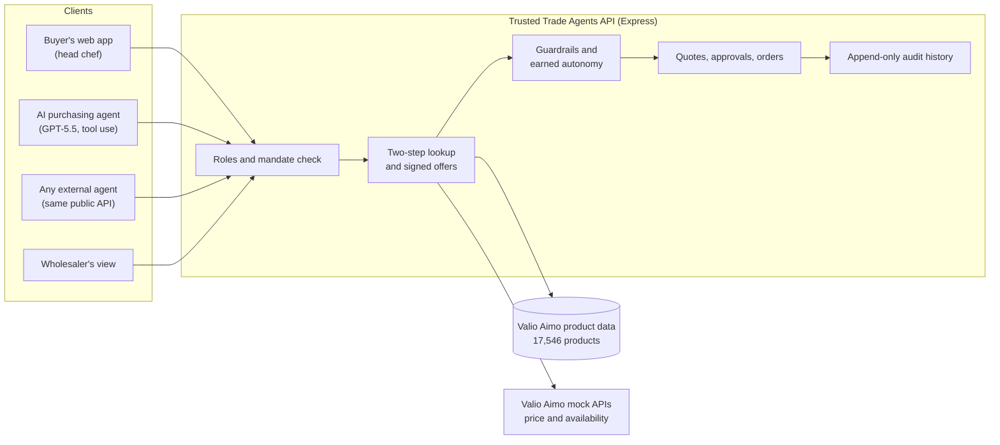
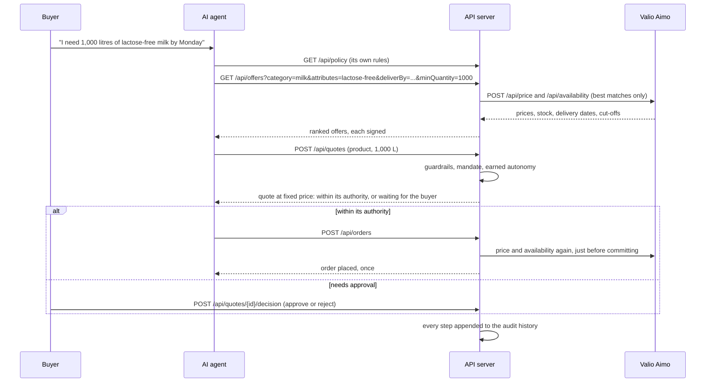

# Architecture

The system has three kinds of clients and one server. The server is the only part that talks to Valio Aimo, holds the buyer's rules, and decides what an agent may do.

## The parts

| Part | Where | What it does |
| --- | --- | --- |
| Frontend | `frontend/` | The buyer's purchasing desk and the wholesaler's view, in English and Finnish. React and Vite. In development the Vite proxy adds the buyer's demo token; in production the backend does. |
| API | `backend/src/app.ts`, `backend/src/routes/` | One Express app. Every route is in the OpenAPI document, and a test fails if one is missing. |
| Authentication | `backend/src/auth.ts` | Bearer tokens map to a role: agent, buyer, or wholesaler. An agent is also checked against the buyer's mandate on every request. |
| Lookup | `backend/src/services/market.ts`, `catalog.ts` | Searches the static product data, then asks Valio Aimo for live price and availability for the best matches only. |
| Valio Aimo client | `backend/src/services/valio.ts` | The only code that calls Valio Aimo. Batches, caches, paces calls, and honours the rate limit. The API key never leaves the server. |
| Signing | `backend/src/services/signing.ts` | Signs product and quote offers as compact JWS (EdDSA, Ed25519). The public key is published as a JWK Set. |
| Mandates | `backend/src/services/mandates.ts` | The buyer's permission for each agent as a W3C Verifiable Credential, issued by the buyer's did:key. |
| Guardrails | `backend/src/services/permissions.ts` | Applies the buyer's rules to a quote: limits, allergens, attributes, labels, nutrition, suppliers, the mandate. |
| Earned autonomy | `backend/src/services/autonomy.ts` | Tracks each agent's record per product category and decides where it may order alone. |
| Quotes and orders | `backend/src/services/quotes.ts`, `orders.ts` | Fixed-price quotes, the buyer's decisions, and orders that can be placed only once per quote. |
| Exceptions | `alternatives.ts`, `substitutes.ts`, `shortfall.ts`, `stockWatch.ts` | Alternatives behind each choice, substitutes by recipe role, shortfall options, and the agent's own stock watch. |
| Kitchen data | `backend/src/data/` | The kitchens' recipes, inventory, planned orders, track records, and the wholesaler's launches. Ours, not Valio Aimo's. |
| AI agent | `backend/src/agent/` | Runs a request through the public API with the agent's own token, using 16 tools. It gets no shortcut past any rule. |
| MCP layer | `backend/src/mcp/`, `routes/mcp.ts` | Lists the agent's 16 tools to MCP clients over stdio or HTTP and forwards each call to the REST API with that client's token. |
| Audit | `backend/src/services/audit.ts` | Appends a frozen entry for every step, in English and Finnish. No route edits or deletes one. |

## Following one request

## Design choices

**Rules are enforced where the data is.** An agent's rules, limits, and mandate are stored with the API. The agent can look them up, has no request that alters them, and every quote is measured against them. Even a model talked into ignoring its instructions gets nowhere, as the adversarial tests demonstrate.

**Agents use the public API like anyone else.** The built-in AI agent calls the same endpoints as an external agent would, with its own token. Nothing it does is possible only because it runs inside the server.

**Lookup in two steps.** The organizers ask that live price and availability are fetched only for products already narrowed down. Search runs over the 17,546-product file in memory; only the best 20 matches (50 at most) are priced live.

**Fixed prices, never negotiated.** A quote locks Valio Aimo's catalog price per sales unit. Clients never send prices, and a signed offer whose price no longer matches is refused.

**Trust is earned per category.** A new agent is supervised, as a person's orders are approved today. It earns the right to act alone in a category from the buyer's approvals, and loses it on a rejection or a blocked attempt. See [Trust and controls](trust-and-controls.md#earned-autonomy).

**Everything is explainable, in two languages.** Each decision carries the rules checked, the alternatives not chosen, and why. The server writes each sentence in English and Finnish, so the buyer reads the reason in their own language.

**State is in memory.** Quotes, orders, and the audit history live in memory and reset with the demo. The data model is persistence-ready; see [the path to production](standards-and-production.md#path-to-production).
