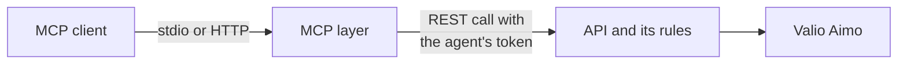

# Using the interface from an MCP client

Agents built on the [Model Context Protocol](https://modelcontextprotocol.io) can buy from Valio Aimo here without writing integration code. The MCP server is a thin translation layer: it lists the built-in agent's 16 tools and forwards each call to the REST API using the calling agent's token.

Because of that, nothing changes about how a purchase is judged. Signed offers, catalog prices, the kitchen's rules, the buyer's mandate, earned autonomy, and the activity history work exactly as they do for a REST caller. There is no tool for approving a quote; that decision is made by the head chef in the buyer's app.



## The tools

They are grouped here by purpose; the names are the same ones the built-in agent uses.

- **Finding products:** `search_products`, `compare_offers` (ranked, with live price and availability), `find_substitutes`.
- **Knowing its limits:** `get_my_policy` returns the kitchen's rules, which the agent can read but not change.
- **Buying:** `create_quote` fixes Valio Aimo's catalog price; `get_quote` and `recheck_quote` follow it; `place_order` succeeds only when the server says the quote is within the agent's authority; `get_shortfall_options` helps when stock has run short.
- **Kitchen planning:** `find_recipes` and `plan_menu` turn a menu into quantities.
- **Ongoing work:** `get_alerts`, `review_standing_order`, `renew_standing_order`, `get_suggestions`, `quote_suggestion`.

Tools that only look things up carry `readOnlyHint`, so clients may run them without asking the user. Each result contains the REST call made, a one-line outcome, and the response data, both as text and as structured content.

Two more things are available to clients that support them. **Resources:** `tta://purchasing-guide` (the steps from a need to an order, in Markdown), `tta://policy` (the agent's own rules), and `tta://openapi` (the REST contract). **Prompt:** `quote-a-need`, which takes a need and an optional delivery date and asks the agent to work through the steps.

## Connecting a desktop client

Run the app with `npm run dev`. The command `npm run mcp` then starts the MCP layer as a local process that talks to the API at `TTA_API_URL` (`http://localhost:3001/api` unless set) as the agent whose token is in `TTA_AGENT_TOKEN`. Without that variable it uses `AGENT_TOKEN` from `.env`, the hotel chain's agent; `SCHOOL_AGENT_TOKEN` makes it the school kitchen's.

Most desktop clients read a JSON entry like this one. Put it in the client's MCP settings file and point the path at your checkout:

```json
{
  "mcpServers": {
    "trusted-trade-agents": {
      "command": "npm",
      "args": ["run", "--silent", "mcp", "--prefix", "/path/to/Junction-Valio-Aimo"],
      "env": { "TTA_AGENT_TOKEN": "demo-agent-token" }
    }
  }
}
```

With Claude Code the same thing is one command:

```bash
claude mcp add trusted-trade-agents -e TTA_AGENT_TOKEN=demo-agent-token -- npm run --silent mcp --prefix /path/to/Junction-Valio-Aimo
```

## Connecting over the network

A running app also answers MCP at `POST /api/mcp`, using Streamable HTTP without sessions. The agent's token goes in the `Authorization: Bearer` header. Agent tokens are the only ones accepted: a request with no token or an unknown one is answered `401`, and a buyer's or wholesaler's token `403`. In the Docker image this endpoint shares the app's port, so a hosted demo can be reached by remote clients.

To see the raw protocol, list the tools with a single request:

```bash
curl -X POST http://localhost:3001/api/mcp \
  -H "Authorization: Bearer demo-agent-token" \
  -H "Content-Type: application/json" -H "Accept: application/json, text/event-stream" \
  -d '{"jsonrpc":"2.0","id":1,"method":"tools/list"}'
```

## A first conversation

Once connected, give the agent the brief's request: "We need 1,000 litres of lactose-free milk delivered on Monday." It looks up its rules, compares lactose-free milks that can arrive on Monday, and quotes the cheapest per litre, Valio's at €1.01. Milk is not one of its earned categories yet, so the server parks the €1,010 quote for the head chef. After the head chef approves it in the buyer's app, the agent may order the same amount of milk by itself next time.

The activity history shows each of these calls under the kitchen's agent, exactly as it shows calls made over REST.

The server is implemented in `backend/src/mcp/` and `backend/src/routes/mcp.ts`, and `backend/test/mcp.test.ts` exercises it with the official MCP client.
